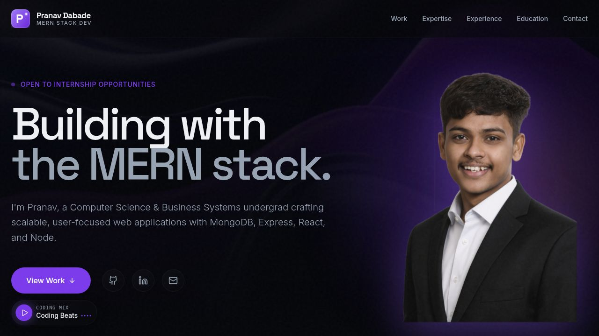

# Pranav Dabade — Portfolio

Personal portfolio website for Pranav Dabade, a MERN Stack / Full Stack Developer. Built with React 18, TypeScript, and Vite.

<p align="center">
  
</p>

---

## 🌐 Live

**[https://portfolio-pranav-alpha.vercel.app/](https://portfolio-pranav-alpha.vercel.app/)**

---

## 🛠️ Tech Stack

| Layer | Technology |
|---|---|
| UI library | React 18 |
| Language | TypeScript 5 |
| Build tool | Vite 5 |
| Styling | Tailwind CSS 4 |
| Animations | Framer Motion 11 |
| Routing | Wouter 3 |
| Icons | Lucide React |
| UI primitives | Radix UI (Toast, Tooltip) |
| Data fetching | TanStack React Query 5 |

---

## ✨ Features

- Fully responsive — mobile, tablet, and desktop
- Dark-mode-only design with ambient glow effects
- Smooth scroll and Framer Motion page animations
- Accessible — semantic landmarks, ARIA labels, reduced-motion support
- Spotlight hover effect on cards
- Circular animated resume download button
- Contact form that opens the user's email client pre-filled
- Separate `/education` page with certifications section
- Deployed on Vercel with sitemap and OpenGraph tags

---

## 📂 Projects Showcased

**CloudVault** — Cloud-based file sharing platform  
React.js · Node.js · Express.js · MongoDB Atlas · AWS S3 · JWT  
[Live](https://cloudvault-1-9w0z.onrender.com/)

**HeartInsights** — Heart disease prediction app  
React.js · Node.js · MongoDB · Python · Flask · scikit-learn  
[Live](https://heartinsights.vercel.app) · [GitHub](https://github.com/PranavDDabade/heartinsights)

---

## 🚀 Getting Started

### Prerequisites

- Node.js v18 or higher
- npm

### Install dependencies

```bash
npm install
```

### Start the development server

```bash
npm run dev
```

Open [http://localhost:5173](http://localhost:5173) in your browser. The server supports hot module replacement — changes reflect instantly without a full reload.

---

## 📜 Available Scripts

| Command | Description |
|---|---|
| `npm run dev` | Start the Vite development server |
| `npm run build` | Compile TypeScript and produce a production build in `dist/` |
| `npm run preview` | Serve the production build locally for final checks |

---

## 📁 Project Structure

```
PortfolioPranav/
├── public/
│   ├── images/          # Hero background, profile, and project screenshots
│   ├── Pranav_Dabade_Resume.pdf
│   ├── favicon-v2.svg
│   ├── sitemap.xml
│   └── robots.txt
└── src/
    ├── components/
    │   ├── NavLogo.tsx
    │   └── SpotlightCard.tsx
    ├── hooks/
    │   ├── use-mobile.tsx
    │   └── use-toast.ts
    ├── lib/
    │   └── utils.ts
    ├── pages/
    │   ├── home.tsx       # Main portfolio page
    │   ├── education.tsx  # Education & certifications page
    │   └── not-found.tsx  # 404 page
    ├── App.tsx
    ├── main.tsx
    └── index.css
```

---

## 👤 Author

**Pranav Dabade**

- Email: [pranavddabade@gmail.com](mailto:pranavddabade@gmail.com)
- GitHub: [github.com/PranavDDabade](https://github.com/PranavDDabade)
- LinkedIn: [linkedin.com/in/pranav-dabade](https://www.linkedin.com/in/pranav-dabade)

---

## 📄 License

This project is open-source and available under the [MIT License](LICENSE).
